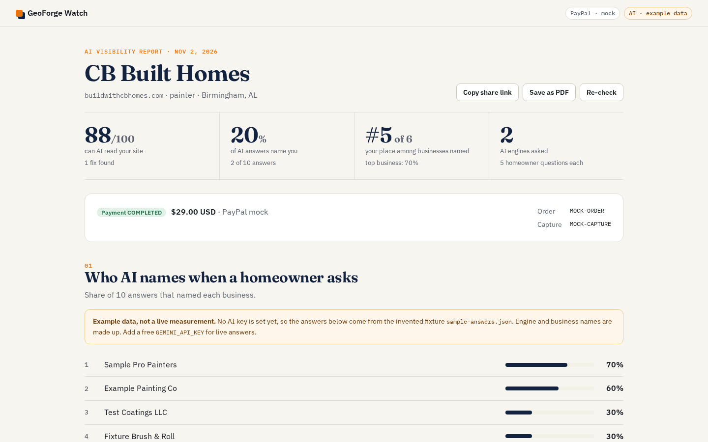
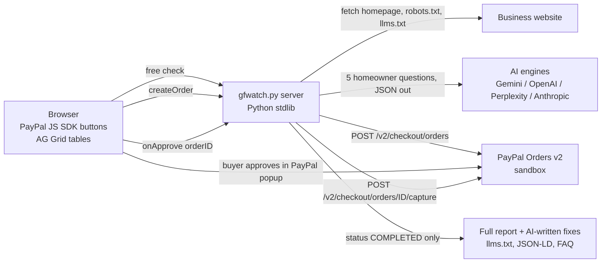

# GeoForge Watch

When a homeowner asks ChatGPT for a roofer in Birmingham, three names come back. This tool tells a local business whether it is one of them, who is named instead, and the specific fixes that help AI read its site.

Built for the PayPal AI Hackathon (submission closes Thu Nov 12, 2026, 12:00 pm PT). Built with my AI agent under my direction (Gaige Roberson, with Monty, a Grok Bot agent, writing most of the code).

## For judges: try it in 60 seconds
```
git clone https://github.com/4Gaige/geoforge-watch && cd geoforge-watch
python3 gfwatch.py serve --mock --demo-answers --port 8787     # no keys at all: mock checkout + labeled example data
# open http://127.0.0.1:8787, enter any real local business site, click "Run free check", then "Pay $29 (mock checkout)"
```
With PayPal sandbox keys in `.env` the same flow uses real PayPal Smart Buttons (sandbox). Add a free `GEMINI_API_KEY` and the AI answers and fixes are live instead of example/template data. Python 3.10+, standard library only, nothing to install.



## Architecture


## PayPal features used
- [x] OAuth 2.0 client-credentials token (cached until expiry), secret kept server-side
- [x] Orders v2 create: `intent=CAPTURE`, item breakdown, `DIGITAL_GOODS` category, `experience_context` (brand name, `NO_SHIPPING`, `PAY_NOW`, return/cancel URLs)
- [x] PayPal JS SDK Smart Buttons (`createOrder` / `onApprove`), client ID only in the browser
- [x] Orders v2 capture; report unlocks **only** on `COMPLETED`, and only for an order this server created
- [x] Order ID and capture ID shown on the receipt
- [x] Refusal path tested: `paypal-selftest` proves an unapproved capture returns 422 `ORDER_NOT_APPROVED`
- [x] Subscriptions v1: weekly watch at $29/month. The server creates a catalog product and monthly billing plan once (`/v1/catalogs/products`, `/v1/billing/plans`), the JS SDK renders Subscribe buttons (`vault=true&intent=subscription`), and the server checks `/v1/billing/subscriptions/{id}` before it confirms the watch
- [ ] Planned: Venmo button, scheduled weekly re-check job

## What was built during the hackathon
Everything in this repo was written during the PayPal AI Hackathon submission period (see the commit history, starting Oct 31 2026): the site check, the PayPal Orders v2 sandbox checkout and Smart Buttons, the multi-engine AI provider layer with structured JSON output, the post-payment fix generator, the AG Grid tables and CSV export, and the report design. Built with my AI agent under my direction (Gaige Roberson, with Monty, a Grok Bot agent, writing most of the code).

## AI engines
Set any one key (more engines = more coverage); the app shows which engine said what.
| Engine | Env var | Default model (override `GFW_<ENGINE>_MODEL`) |
|---|---|---|
| Google Gemini (free tier) | `GEMINI_API_KEY` | gemini-2.5-flash |
| OpenAI | `OPENAI_API_KEY` | gpt-4o-mini |
| Perplexity | `PERPLEXITY_API_KEY` | sonar |
| Anthropic | `ANTHROPIC_API_KEY` | claude-3-5-haiku-latest |

Each engine answers the homeowner question and returns JSON listing every business it named, so competitor names come from the model, not from text patterns. After payment, the first engine with a key writes a ready-to-paste `/llms.txt`, LocalBusiness JSON-LD and FAQ copy for the checked site, using only facts found on the page (unknowns become [BRACKETED] placeholders). With no key, a fixed template fills these in and the page says **TEMPLATE, NOT AI-WRITTEN**.

## What it does
1. Free site check (no key needed): homepage status, AI crawler rules in robots.txt (GPTBot, OAI-SearchBot, ClaudeBot, PerplexityBot, Google-Extended and others), /llms.txt, LocalBusiness JSON-LD, title, meta description, phone in text, question-style content. Scored out of 100 with a fix list.
2. AI answer check: asks five buyer-style questions ("Who are the best painters in Birmingham, AL?") to the AI providers you have keys for, then counts how often the business is named and which competitors are named instead. With no key, it prints the questions so you can paste answers from the free chat apps (manual mode, labeled as such in the report).
3. Paid report through PayPal: the free check ends with a $29 checkout. PayPal Orders v2 REST (sandbox, Python stdlib only) creates an order for "GeoForge Watch full report" ($29.00 USD), sends the buyer to PayPal to approve, captures on return, and unlocks the full report **only when the capture status is COMPLETED**. An unapproved or forged order returns an error and the report stays locked. The page also shows PayPal JS SDK Smart Buttons (client ID only in the browser; the secret stays on the server).

- Tables built with [AG Grid Community](https://www.ag-grid.com/) (MIT, loaded from jsdelivr): every answer by engine and query (sortable, filterable, pinned engine column), a competitor table grouping all answers by business with a mention-rate bar and per-engine counts, and CSV export of both.

## Run it
```
python3 gfwatch.py readiness https://buildwithcbhomes.com
python3 gfwatch.py prompts --trade painter --city "Birmingham, AL" > answers.json   # paste answers in
python3 gfwatch.py report https://buildwithcbhomes.com --business "CB Built Homes" --trade painter --city "Birmingham, AL" --answers-file answers.json
cp .env.example .env    # fill in your sandbox app keys
set -a; . ./.env; set +a
python3 gfwatch.py paypal-selftest   # creates a sandbox order, checks an unapproved capture is refused
python3 gfwatch.py serve --port 8787 # add --mock to force mock checkout, --host 0.0.0.0 to host it
python3 gfwatch.py fixes https://buildwithcbhomes.com --business "CB Built Homes" --trade painter --city "Birmingham, AL"
```
Python 3.10+, standard library only. Sandbox is the default when `PAYPAL_SANDBOX_CLIENT_ID` and `PAYPAL_SANDBOX_CLIENT_SECRET` are set; with no keys (or `--mock` / `GFW_MOCK=1`) checkout runs in mock mode and says so on screen.

Demo mode for the AI-answer section: `python3 gfwatch.py serve --demo-answers` (or `GFW_DEMO_ANSWERS=1`). With no AI key set, it loads the invented `sample-answers.json` fixture and the report shows a banner saying it is EXAMPLE DATA, not a live measurement. Any AI key set means live answers are used instead.

The paid page shows the PayPal order ID and capture ID.

## PayPal sandbox setup
1. At developer.paypal.com, create a Sandbox REST app (Merchant).
2. Copy its Client ID and Secret into `.env` (see `.env.example`). `.env` is git-ignored; never commit keys.
3. Pay with a sandbox Personal (buyer) account from the Sandbox Accounts page.
Optional AI keys: GEMINI_API_KEY (free tier), OPENAI_API_KEY, PERPLEXITY_API_KEY, ANTHROPIC_API_KEY.

## Judges: test credentials
Use any PayPal sandbox Personal account, or run with your own sandbox app keys. A demo buyer login will be listed in the Devpost submission.

## Honest limits
- AI answers vary run to run; the report is a snapshot.
- Live engines list the businesses they named as JSON. Answers you paste in by hand (manual mode) still use simple patterns (numbered or bold names) and can miss some.
- No ranking is promised.

## v3 report (Nov 2)
- Ranked list of every business AI named, with yours marked (names unlock after payment)
- Per-engine cards (one square per question) and a business × engine heat matrix in AG Grid, CSV export
- Action plan with priority, impact and effort for each fix
- Full answer text as cards with every business name highlighted (replaces the cramped excerpt column)
- Share link: each paid report gets an unguessable `/r/<token>` URL, saved under `data/` (git-ignored)
- Save as PDF through a print stylesheet
- Re-check button and an "Over time" trend for each site, saved per check
- Design notes and references: [docs/design-v3.md](docs/design-v3.md)

## Roadmap inside the hackathon window
- PayPal Subscriptions for weekly monitoring ($29/mo draft price), with a change alert when the mention rate drops.
- Venmo button on mobile checkout.
- Report PDF; re-check after fixes are published to show the score change.

## Example data
`sample-answers.json` and `sample-report.md` are invented test fixtures. The competitor names in them are made up.

## License
MIT. See [LICENSE](LICENSE). Copyright (c) 2026 Gaige Roberson.
